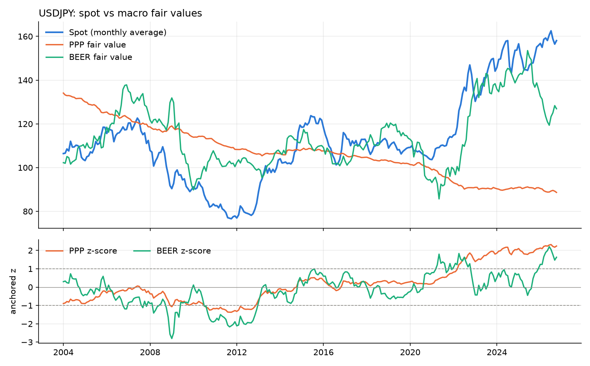
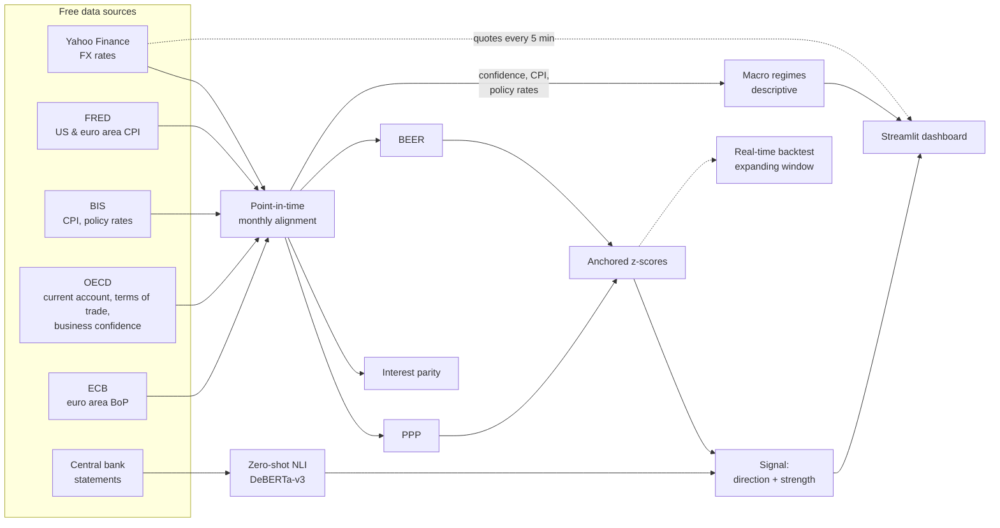

# FX Macro Mispricing Monitor

**Detecting potentially mispriced currencies by combining macroeconomic fair-value models with NLP-based analysis of central bank communication.**

The system estimates three fair values for each currency pair (purchasing power parity,
interest rate parity and a behavioural equilibrium exchange rate model) and measures how far the
market rate deviates from them. It then checks whether the tone of the two central banks confirms
or contradicts the deviation, using a zero-shot transformer classifier. The result is a
continuously refreshed dashboard, deployed on a 1 GB cloud VM.

Pairs covered: **EURUSD · USDJPY · GBPUSD · USDCHF · AUDUSD** (configurable).



*USDJPY since 2004. Top: monthly spot against the PPP and BEER fair values. Bottom: deviation
from each model in standard deviations; dashed lines are the ±1σ signal thresholds. By late 2026,
both models flag the yen as undervalued (PPP z = +2.2, BEER z = +1.6).*

### Highlights

- **Three fair-value models**: relative PPP, covered and uncovered interest parity, and a BEER
  regression with Newey-West inference and an Engle-Granger cointegration test.
- **Strictly point-in-time data**: every series is lagged by its publication delay, and quarterly
  data become step functions, never interpolated. No look-ahead in the data alignment (model
  calibration is tested separately in the real-time backtest, section 8).
- **Central bank sentiment** from a zero-shot NLI model (DeBERTa-v3), evaluated against FinBERT on
  a hand-labelled set: **82 % vs 62 % accuracy**.
- **Production deployment** on a 908 MB RAM VM: the transformer runs through ONNX Runtime with
  memory-mapped weights, peaking at 687 MB, with no PyTorch on the server.
- **Free data only**: FRED, BIS, OECD, ECB, Yahoo Finance and central bank websites.
- **Macro regime layer**: each economy labelled monthly as goldilocks, reflation, stagflation or
  disinflation, from point-in-time growth and inflation dynamics (descriptive, section 7).
- **Honest evaluation**: an expanding-window backtest removes look-ahead bias from the signal
  history and shows how much of the apparent edge disappears (section 8).
- **Modular, tested codebase**: 96 pytest tests, mostly on synthetic data with known answers.

---

## Contents

1. [Pipeline](#1-pipeline)
2. [Point-in-time data](#2-point-in-time-data)
3. [Fair-value models](#3-fair-value-models)
4. [Measuring mispricing](#4-measuring-mispricing)
5. [Central bank sentiment](#5-central-bank-sentiment)
6. [Signal](#6-signal)
7. [Macro regimes](#7-macro-regimes)
8. [Results snapshot](#8-results-snapshot)
9. [Engineering](#9-engineering)
10. [Quickstart](#10-quickstart)
11. [Limitations and next steps](#11-limitations-and-next-steps)
12. [References](#references)

---

## 1. Pipeline



The workload is split in two:

- **A batch job**, run twice a day, downloads the data, re-estimates the models, scores the
  central bank statements and computes the macro regime of each economy.
- **A lightweight dashboard** pulls the latest quote every five minutes and recomputes the
  deviations and the signal against the stored fair values, without re-running any model. It also
  shows the macro regimes, as a table of the current state and a timeline over the last ten years.

Macro data are monthly or quarterly, so re-estimating the models more often would change nothing.
Only the exchange rate moves intraday, so only the exchange rate is refreshed intraday.

---

## 2. Point-in-time data

Mixing a daily exchange rate with monthly CPI and quarterly national accounts is where look-ahead
bias usually creeps in. Every transformation in the project uses only information that was
**published** at the date in question.

| Issue | Treatment |
|---|---|
| Daily FX vs monthly CPI | Monthly **average** of the spot rate. The CPI is itself an average price level over the month. |
| CPI for month $m$ is released in $m+1$ | Series shifted forward by its publication lag: $\tilde P_t = P_{t-\ell}$, with $\ell = 1$ month. |
| Quarterly data (current account, deflators) | Released about 3 months after quarter end, then **carried forward** as a step function until the next release. Never interpolated, since interpolation would use the next, unpublished quarter. |
| Australian CPI (quarterly, repeated monthly at the source) | Lag of 4 months: the January value (Q1) is only known at the end of April. |
| Latest CPI not yet published (used in real rates for the BEER) | 12-month inflation is computed on published CPI only, then carried forward; carrying the CPI level forward first would invent an inflation rate. The price *level* itself is carried forward for PPP, which is correct. |
| BoJ quantitative-easing regimes with no policy-rate target | Filled with 0 %, the prevailing money-market rate, rather than interpolated. |
| Euro area current account before 2013 (missing at the OECD) | Rebuilt from ECB balance-of-payments data and GDP, then level-adjusted to the OECD series on their 2013–2022 overlap. |

---

## 3. Fair-value models

**Notation.** A pair `XXXYYY` is quoted as units of `YYY` per unit of `XXX`. $S_t$ is the spot
rate, $P_t$ a price index and $i_t$ an interest rate.

### 3.1 Relative purchasing power parity (PPP)

If prices rise faster in country `YYY`, its currency should depreciate in proportion:

$$FV^{PPP}_t = k \cdot \frac{P^{YYY}_t}{P^{XXX}_t}$$

Relative PPP pins down *changes* only, so the constant $k$ has to be calibrated. Anchoring $k$ on
a single base date makes the result depend on whether the exchange rate happened to be at
equilibrium that day. Instead, the model assumes PPP holds **on average** over the sample, i.e.
the log real exchange rate is mean-reverting:

$$\ln k = \frac{1}{T}\sum_{t=1}^{T}\left[\ln S_t - \ln\frac{P^{YYY}_t}{P^{XXX}_t}\right]$$

This is consistent with the evidence that PPP deviations have a half-life of 3 to 5 years
(Rogoff, 1996), so the calibration window needs to span several cycles.

### 3.2 Interest rate parity

**Covered interest parity (CIP)** is a no-arbitrage condition. Investing in `XXX` at $i_{XXX}$
must yield the same as converting to `YYY`, investing at $i_{YYY}$, and converting back at the
forward rate:

$$F_{t,h} = S_t\left(\frac{1+i^{YYY}_t}{1+i^{XXX}_t}\right)^{h}$$

It also gives the annualised **carry** of a long `XXX` position, approximately
$i^{XXX} - i^{YYY}$.

**Uncovered interest parity (UIP)** adds the assumption that the forward rate is an unbiased
predictor of the future spot rate, $E_t[S_{t+h}] = F_{t,h}$. The UIP fair value today is what the
forward predicted $h$ months ago:

$$FV^{UIP}_t = S_{t-h}\left(\frac{1+i^{YYY}_{t-h}}{1+i^{XXX}_{t-h}}\right)^{h}$$

UIP fails empirically: high-yielding currencies tend not to depreciate as much as predicted (the
forward premium puzzle, Fama 1984). And since $FV^{UIP}$ is essentially the lagged spot rate, its
deviation mostly measures a 12-month excess return. It is therefore reported as a
**momentum/carry indicator** and excluded from the valuation signal.

### 3.3 Behavioural equilibrium exchange rate (BEER)

Following Clark and MacDonald (1998), the log real exchange rate is regressed on relative
fundamentals (`XXX` minus `YYY`):

$$q_t = \ln S_t + \ln P^{XXX}_t - \ln P^{YYY}_t$$

$$q_t = \alpha + \beta_1\,\Delta r_t + \beta_2\,\Delta\ln \mathit{ToT}_t + \beta_3\,\Delta \mathit{CA}_t + \varepsilon_t$$

| Regressor | Definition | Expected sign |
|---|---|---|
| $\Delta r$ | Real policy-rate differential (nominal rate minus 12-month inflation) | + (capital inflows) |
| $\Delta \ln \mathit{ToT}$ | Terms-of-trade differential (export deflator / import deflator) | + (income effect) |
| $\Delta \mathit{CA}$ | Current account differential, % of GDP, 4-quarter average | + (net foreign asset accumulation) |

The fair value maps the fitted real rate back to a nominal one:

$$FV^{BEER}_t = e^{\hat q_t}\cdot\frac{P^{YYY}_t}{P^{XXX}_t}, \qquad \ln\frac{S_t}{FV^{BEER}_t} = \hat\varepsilon_t$$

**Econometrics.**

- OLS in levels, with **Newey-West (HAC)** standard errors over 12 lags, because the residuals are
  highly autocorrelated.
- $q_t$ and the fundamentals are I(1), so a levels regression is only meaningful if they are
  **cointegrated**. Otherwise it is a spurious regression (Granger and Newbold, 1974). This is
  checked with an **Engle-Granger** test, i.e. an ADF test on $\hat\varepsilon_t$ with MacKinnon
  critical values.
- The speed of mean reversion is the **half-life** from an AR(1) fit on the residuals,
  $\ln 0.5 / \ln\hat\rho$.

---

## 4. Measuring mispricing

For each model $m$, the deviation is $e^m_t = \ln(S_t / FV^m_t)$. A positive value means the
base currency is overvalued. Two standardisations answer different questions:

| Measure | Formula | Question it answers |
|---|---|---|
| **Anchored z-score** | $z^m_t = e^m_t / \sigma_m$, with $\sigma_m$ the full-sample std of $e^m$ | How far is the rate from **the model**? |
| Rolling z-score | $(e^m_t - \bar e^m_{60}) / s^m_{60}$ over a 60-month window | How unusual is the deviation **relative to the last five years**? |

They can disagree sharply. In October 2026 the euro was 11.8 % **below** PPP (anchored
$z = -1.0$), yet its rolling z-score was **positive** (+0.4), because it had been even cheaper on
average over the previous five years. The rolling version re-centres on recent history and loses
the economic anchor, so the signal uses the anchored z-score.

---

## 5. Central bank sentiment

### 5.1 Zero-shot classification by natural language inference

Statements from the Fed, ECB, BoE, BoJ, SNB and RBA are scraped (HTML or PDF), cleaned and split
into sentences. Each sentence $x$ is classified by `MoritzLaurer/deberta-v3-base-zeroshot-v2.0`, a
model trained only for **natural language inference**: deciding whether a premise entails a
hypothesis.

For each label $k \in \{\text{hawkish}, \text{dovish}, \text{neutral}\}$, the model scores the
pair ($x$, "This is $k$."). Let $z_k$ be its entailment logit. The class probabilities are a
softmax across labels:

$$P(k \mid x) = \frac{\exp(z_k)}{\sum_{j}\exp(z_j)}$$

The model has never been trained on the word "hawkish". The classification comes entirely from its
general ability to judge entailment.

### 5.2 Aggregation

Each sentence gets a polarity score
$s_i = P_i(\text{hawkish}) - P_i(\text{dovish}) \in [-1, 1]$. A statement's score weights each
sentence by how much monetary policy signal it carries:

$$S = \frac{\sum_i s_i\,\big(1 - P_i(\text{neutral})\big)}{\sum_i \big(1 - P_i(\text{neutral})\big)}$$

so that procedural or purely descriptive sentences barely count.

### 5.3 Evaluation against FinBERT

Both models were evaluated on 45 hand-labelled central bank sentences (15 per class). FinBERT
outputs positive/negative/neutral, mapped naively to hawkish/dovish/neutral.

| Model | Accuracy | F1 hawkish | F1 dovish | F1 neutral |
|---|---|---|---|---|
| **DeBERTa-v3 zero-shot (NLI)** | **0.82** | 0.80 | 0.85 | 0.82 |
| FinBERT | 0.62 | 0.37 | 0.65 | 0.81 |

FinBERT measures **tone**, not **policy stance**. "Inflation remains well above target and further
tightening may be required" sounds negative, so FinBERT labels it dovish, while the message is
clearly hawkish.

The wording of the hypothesis matters a lot. With the same model, macro-F1 ranges from 0.63 with
a long descriptive hypothesis to 0.82 with "This is hawkish." The large model only adds two points
(0.84) for about 5× the compute.

> **Caveat.** The hypothesis wording was selected on these same 45 sentences, so 82 % is an
> optimistic, in-sample figure. A held-out set would be needed for an unbiased estimate.

---

## 6. Signal

**1. Valuation.** A weighted average of the anchored z-scores of the valuation models (UIP is
excluded, see 3.2):

$$z^{val}_t = \frac{\sum_m w_m z^m_t}{\sum_m w_m}, \qquad w_{PPP} = w_{BEER} = 0.5$$

The BEER only enters if it is **cointegrated**: if its Engle-Granger p-value exceeds 0.10, its
z-score is dropped and the weights are renormalised, so $z^{val} = z^{PPP}$. Without cointegration
the BEER regression may be spurious; its z-score is still displayed for information.

**2. Confirmation.** The sentiment differential between the two central banks:

$$\Delta s = S_{XXX} - S_{YYY}$$

A more hawkish central bank supports its currency.

**3. Rule.**

| Valuation | Direction |
|---|---|
| $\lvert z^{val}\rvert < 1$ | neutral |
| $z^{val} \le -1$ (XXX undervalued) | XXXYYY expected to **rise** |
| $z^{val} \ge +1$ (XXX overvalued) | XXXYYY expected to **fall** |

| Sentiment of the **undervalued** currency's central bank vs the other | Strength |
|---|---|
| more hawkish by at least 0.15 | **strong** (confirmed) |
| more dovish by at least 0.15 | **weak** (contradicted) |
| in between, or unavailable | moderate |

All weights and thresholds are set in `config.yaml`.

---

## 7. Macro regimes

A **descriptive** layer that labels, each month, the macro environment of each of the six
economies. It does not feed the valuation signal and is not a forecast: it gives context for
reading the signal (e.g. an undervalued currency in a stagflation regime).

**Data** (all point-in-time, lagged by their publication delay):

| Input | Source | Publication lag |
|---|---|---|
| Growth proxy: business confidence indicator, amplitude-adjusted (100 = long-run average) | OECD, `DSD_STES@DF_CLI`, measure `BCICP` | 1 month (2 for Switzerland and Australia) |
| 12-month CPI inflation | FRED / BIS (as in section 2) | 1 month (4 for quarterly Australian CPI) |
| Policy rate | BIS | none |

The OECD composite leading indicator (CLI) would be the natural growth proxy, but the OECD does not
publish it for the euro area or Switzerland. The business confidence indicator exists for all six
economies, so it is used everywhere to keep a single definition. It leads the cycle less than a
composite indicator does.

**Indicators.** With $B_t$ the confidence index and $\pi_t$ 12-month inflation:

$$g_t = B_t - B_{t-3}, \qquad \Delta\pi_t = \pi_t - \pi_{t-6}$$

plus the gap to a 2 % inflation target and the monetary cycle: the 6-month change in the policy
rate classified as tightening (> +25 bp), easing (< −25 bp) or pause.

**Rule.** The regime is given by the signs of the two dynamics. A change of exactly zero counts as
"not rising".

| | Inflation rising ($\Delta\pi > 0$) | Inflation stable or falling ($\Delta\pi \le 0$) |
|---|---|---|
| **Growth improving** ($g > 0$) | reflation | goldilocks |
| **Growth stable or deteriorating** ($g \le 0$) | stagflation | disinflation |

**Neutral zone.** A dynamic counts as "flat" when $\lvert x_t\rvert < 0.25\,\hat\sigma_t$, where
$\hat\sigma_t$ is the standard deviation of that dynamic estimated on an **expanding window** (past
data only, at least 24 months). A month in which growth **or** inflation is flat proposes no new
regime: the previous one is kept. This rule was added after a first check showed regimes lasting
only about 5 months on average, i.e. flipping on noise. The 0.25σ threshold is a noise criterion
fixed in advance, not tuned to the historical episodes below. As expected from that threshold,
about a third of months are "neutral" (32–41 % depending on the economy).

**Persistence.** A new regime is adopted only after two consecutive months (hysteresis), otherwise
the previous one is kept; a neutral month interrupts the count.

**Unpublished months.** Indicators are computed on the raw published series, and only then is the
latest *computed* value carried forward, for up to 3 months. Carrying the CPI level forward first
would divide an old CPI by a newer 12-month base and invent an inflation rate. A carried-forward
month is flagged ("not yet published") and behaves like a neutral month: it keeps the current
regime and can neither propose nor confirm a change. Beyond 3 months the month is undetermined and
the confirmation restarts, so no regime is ever invented. Every quantity uses only past data
(checked by tests). All thresholds were fixed before looking at the results, except the neutral
zone (see above).

**Current state** (October 2026; "this month" is the unconfirmed reading: *neutral* = one of the
dynamics is within the noise band, *not yet published* = the month's data are not out yet and the
last computed values are shown; the central bank tone is today's score from section 5 and has no
history):

| Currency | Regime | Months in regime | This month | Confidence − 100 | 12m inflation | Gap to target | Monetary cycle | CB tone |
|---|---|---|---|---|---|---|---|---|
| USD | reflation | 4 | neutral | +0.34 | 3.7 % | +1.7 | pause | +0.26 |
| EUR | reflation | 2 | reflation | +0.19 | 3.8 % | +1.8 | tightening | +0.29 |
| JPY | goldilocks | 34 | not yet published | +1.68 | 1.9 % | −0.1 | tightening | −0.03 |
| GBP | disinflation | 5 | not yet published | +1.45 | 3.1 % | +1.1 | pause | +0.29 |
| CHF | stagflation | 4 | not yet published | +0.62 | 0.8 % | −1.2 | pause | +0.18 |
| AUD | stagflation | 6 | neutral | −0.08 | 3.9 % | +1.9 | tightening | +0.20 |

**Sanity check** (`scripts/verifier_regimes.py`; regimes now last 7–12 months on average, against
5–7 before the neutral zone):

- In 2008–09 all six economies move from stagflation to disinflation.
- During the 2021–22 inflation surge they go through reflation, then stagflation.
- In 2023–24 they mostly settle in disinflation or goldilocks.

**Limitations.**

- **Regimes are recognised 3 to 5 months late** (publication lag + 3-month change + two-month
  confirmation). The tool describes trends and misses brief shocks. Covid is the clearest case: the
  collapse in business confidence only shows up in the indicators in April 2020 (euro area, UK) and
  May 2020 (US), and the regime does not change at all, because these economies were already
  classified as disinflation after the 2019 slowdown.
- **Known artefacts.** Japan's consumption-tax hike of October 2019 lifts 12-month inflation for
  exactly one year, then drops out mechanically. Australian CPI is quarterly (repeated over three
  months at the source), so its inflation dynamic moves in steps.
- **No real-time vintages**: OECD indicators are revised after publication, and without archived
  vintages the history uses today's revised values.
- **Thresholds are set a priori**: horizons, the 25 bp band, the 0.25σ neutral zone and the
  two-month confirmation are reasonable choices, not estimated ones. The neutral zone itself was
  added after a first look at the results (see above).

---

## 8. Results snapshot

*As of 17 October 2026. Model output, not investment advice.*

**Valuation and signal**

| Pair | Spot | PPP gap | BEER gap | $z^{PPP}$ | $z^{BEER}$ | BEER p (EG) | $z^{val}$ | Signal |
|---|---|---|---|---|---|---|---|---|
| EURUSD | 1.124 | −11.6 % | +7.3 % | −1.01 | +0.96 | 0.23 → excluded | **−1.01** | **EURUSD ↑, moderate** |
| USDJPY | 157.99 | +78.2 % | +24.5 % | +2.24 | +1.63 | 0.93 → excluded | **+2.24** | **USDJPY ↓, weak** |
| GBPUSD | 1.333 | −8.2 % | +12.1 % | −0.64 | +1.34 | 0.06 → included | +0.35 | neutral |
| USDCHF | 0.824 | +7.3 % | −3.1 % | +0.86 | −0.51 | 0.13 → excluded | +0.86 | neutral |
| AUDUSD | 0.695 | −11.5 % | −9.4 % | −0.82 | −1.16 | 0.66 → excluded | −0.82 | neutral |

Only GBPUSD keeps its BEER. The yen is undervalued against the dollar, but the signal is **weak**
because the Fed's statement scores more hawkish (+0.26) than the BoJ's (−0.03). For EURUSD, PPP
and BEER pointed in opposite directions and cancelled out; with the non-cointegrated BEER removed,
the euro's 11.6 % PPP undervaluation now triggers a signal, of moderate strength because the ECB
and Fed sound about equally hawkish (Δs = +0.03).

**BEER estimates** (monthly, 2000–2026; HAC t-statistics; bold = significant at 5 %)

| Pair | $\beta_{\text{real rate}}$ | $\beta_{\text{ToT}}$ | $\beta_{\text{CA}}$ | $R^2$ | Engle-Granger p | Half-life |
|---|---|---|---|---|---|---|
| EURUSD | 0.007 | **1.41** | −0.014 | 0.65 | 0.23 | 12 m |
| USDJPY | **0.030** | **1.11** | **−0.032** | 0.72 | 0.93 | 20 m |
| GBPUSD | 0.013 | **1.76** | **0.031** | 0.57 | 0.06 | 11 m |
| USDCHF | 0.014 | **0.48** | −0.003 | 0.45 | 0.13 | 9 m |
| AUDUSD | **0.028** | **0.52** | **−0.036** | 0.69 | 0.66 | 6 m |

- **Terms of trade** come out with the expected sign and are significant for every pair.
- **Cointegration is not established at the 5 % level for any pair** (GBPUSD is closest, at
  p = 0.06). This is common with about 25 years of monthly data, where the test has low power,
  but the BEER fair values should be read with caution.
- The **current account** has the wrong sign for EUR, JPY and AUD. This is consistent with reverse
  causality (a weak currency improves the trade balance), which biases OLS. Net foreign assets, a
  stock rather than a flow, would be the standard fix.

### Real-time backtest

How useful would the valuation signal have been? Section 3 calibrates PPP, the BEER and each
$\sigma_m$ on the **full sample**, so at any past date the z-score uses data from the future. The
backtest (`scripts/backtest_temps_reel.py`) instead re-calibrates every model at each date $t$ on
data up to $t$ only (an **expanding window**), then measures the pair's log return over the next
12 months, signed by the signal. All versions are evaluated on the same dates (2009 onwards),
threshold $\lvert z\rvert \ge 1$. On the last date, the real-time and full-sample z-scores coincide,
so today's signal is unaffected.

*Average of the 5 pairs:*

| Version | Months with a signal | Hit rate | Mean 12-month return | Independent obs. (pooled) |
|---|---|---|---|---|
| a) Full-sample calibration (look-ahead) | 28.8 % | 69.3 % | +4.96 % | 22 |
| b) Real time, PPP + BEER | 43.7 % | 53.8 % | +0.91 % | 38 |
| c) Real time, PPP only | 59.7 % | 54.4 % | +0.94 % | 55 |
| d) Real time, BEER only when cointegrated | 55.2 % | 52.2 % | +0.85 % | 49 |

*Per pair (months with a signal / hit rate):*

| Pair | a) full sample | b) real time | c) PPP only | d) BEER if cointegrated |
|---|---|---|---|---|
| EURUSD | 29 % / 90 % | 28 % / 68 % | 61 % / 57 % | 46 % / 58 % |
| USDJPY | 33 % / 38 % | 75 % / 32 % | 87 % / 38 % | 87 % / 38 % |
| GBPUSD | 28 % / 74 % | 50 % / 49 % | 61 % / 56 % | 52 % / 51 % |
| USDCHF | 26 % / 69 % | 35 % / 56 % | 38 % / 68 % | 40 % / 61 % |
| AUDUSD | 29 % / 76 % | 31 % / 65 % | 51 % / 53 % | 51 % / 53 % |

- **Most of the apparent edge is look-ahead.** Calibrating on the full sample tells the model in
  advance where the long-run mean lies, so the hit rate drops from about 69 % to about 54 % once
  only past data are used, and the mean 12-month return from +5.0 % to +0.9 %.
- **Monthly 12-month returns overlap.** Two consecutive months share 11 months of return, so the
  hundreds of monthly observations are far from independent. Keeping one month every 12 leaves only
  **38 independent signals** for version b (21 correct, 55 %).
- **54 % is not distinguishable from a coin flip.** Binomial tests against 50 % on the
  non-overlapping observations give: real time (version b): 55 % on 38 independent obs.,
  p = 0.63; full-sample calibration (with look-ahead, version a): 64 % on 22, p = 0.29.
  A greedy non-overlapping sample (keep an active month, skip 12 months, repeat) gives, for
  version b, 53 observations with a 58 % hit rate (31 of 53), p ≈ 0.27. The conclusion, no
  statistical significance, therefore does not depend on how the independent sample is drawn.
- **Even 38 overstates the evidence.** These observations pool 5 currency pairs that are
  themselves correlated (4 of the 5 contain the US dollar), so the effective number of
  independent observations is smaller still.
- **USDJPY is the main failure.** Since 2013 the yen has looked cheap on PPP almost continuously
  and kept getting cheaper; real-time hit rate 32 % (see the value trap in section 11).

Neither transaction costs nor carry are included: this is a test of predictive content, not a
measure of profitability.

---

## 9. Engineering

### Running a transformer on a 1 GB VM

The production server has 908 MB of RAM and also hosts another service. PyTorch plus DeBERTa needs
about 1.5 GB, so it does not fit.

- The model is exported once to **ONNX** and served with **ONNX Runtime**, so PyTorch is not
  installed on the server.
- **Int8 quantisation was tested and rejected.** Dynamic int8 quantisation cut accuracy from 82 %
  to 22 % (58 % at best with per-channel quantisation), because DeBERTa-v3
  has extreme activation outliers. The weights are kept in **float32**, in an external data file
  that the OS **memory-maps** rather than copies, with weight pre-packing and the CPU memory arena
  disabled.
- **Result**: identical probabilities to PyTorch (checked by a test), a peak RSS of **687 MB**,
  and a full update in about 3 minutes on 2 vCPUs, plus a 1 GB swap file as a safety margin.

### Deployment

- **Python environment**: Python 3.13 and dependencies installed with `uv`; the app runs under a
  dedicated system user.
- **systemd units**: one long-running service for the dashboard, and a timer for the batch job
  (07:00 and 19:00 Paris time, with catch-up if the machine was down).
- **Access**: the dashboard binds to localhost only and is reached through an SSH tunnel, since
  Streamlit has no built-in authentication.
- **Machine-specific settings**: a `config.local.yaml` deep-merged over `config.yaml` switches the
  sentiment engine to ONNX on the server.
- **Fault tolerance**: if a data source fails, the job falls back to its cached copy for up to
  30 days and reports it as stale (in `maj.json` and on the dashboard); beyond that it fails
  loudly, since silently serving month-old data is worse than an error.

### Testing

**96 pytest tests**, mostly on synthetic data with known answers. For example:

- PPP fair value doubles when relative prices double;
- the CIP forward satisfies no-arbitrage;
- the BEER recovers the true coefficients of a simulated cointegrated system and flags an
  independent random-walk pair as non-cointegrated;
- the AR(1) half-life is recovered;
- quarterly data never appear before their publication date;
- every branch of the signal rule is exercised, including the BEER cointegration filter;
- the real-time backtest is unaffected by data posted after each date (no look-ahead);
- macro regimes: the four sign rules (including zero changes), two-month persistence, the
  neutral zone (whose expanding-window σ ignores future data), carried-forward months that never
  invent an inflation rate nor confirm a change, and no look-ahead;
- a failing source falls back to its cache only up to a maximum age, and is reported;
- ONNX and PyTorch outputs match.

### Tech stack

| Area | Tools |
|---|---|
| Data | pandas, NumPy, PyArrow (parquet cache), requests, yfinance |
| Econometrics | statsmodels (OLS with HAC errors, Engle-Granger) |
| NLP | Hugging Face Transformers, PyTorch (development), ONNX / ONNX Runtime, `tokenizers` (production) |
| Scraping | BeautifulSoup, pypdf |
| Dashboard | Streamlit, Altair |
| Ops | uv, systemd, rsync over SSH, AWS EC2 |
| Tests | pytest |

### Repository structure

```
fxmacro/
├── donnees/        # data: FRED, BIS, OECD, ECB, Yahoo; cache; point-in-time alignment
├── fair_value/     # ppa.py (PPP), parite_taux.py (CIP/UIP), beer.py, ecarts.py (z-scores)
├── sentiment/      # scraping, zero-shot NLI (PyTorch & ONNX), FinBERT, aggregation, evaluation
├── signaux/        # valuation + sentiment combination, live re-evaluation, backtest
├── regime/         # macro regimes: indicators, classification with persistence
└── pipeline.py     # data → fair values → deviations for one pair
app/                # Streamlit dashboard
scripts/            # batch update, ONNX export, demo scripts
tests/              # pytest suite
deploiement/        # systemd units and deployment guide
config.yaml         # pairs, data sources, model and signal parameters
```

*Identifiers and comments are in French.*

---

## 10. Quickstart

```bash
python3 -m venv .venv
.venv/bin/pip install -r requirements-nlp.txt   # full install incl. PyTorch
.venv/bin/python scripts/exporter_onnx.py        # one-off: export the NLI model to ONNX
.venv/bin/python scripts/mettre_a_jour.py        # download data, fit models, score statements
.venv/bin/python scripts/backtest_temps_reel.py  # real-time vs full-sample backtest
.venv/bin/python scripts/verifier_regimes.py     # macro regimes on known episodes
.venv/bin/streamlit run app/tableau_de_bord.py   # dashboard on http://localhost:8501
.venv/bin/python -m pytest -q                    # run the test suite
```

A FRED API key in `.env` (`FRED_API_KEY=...`) is optional: without one, the public FRED CSV
endpoint is used.

---

## 11. Limitations and next steps

| Limitation | Next step |
|---|---|
| ~~PPP and BEER are calibrated on the full sample, so historical fair values contain look-ahead~~ | **Done**: expanding-window backtest (section 8). It shows no statistically significant edge in real time; next: longer history, more pairs, carry-adjusted returns |
| **USDJPY value trap**: the yen has screened as cheap on PPP since 2013 but kept depreciating, because a large rate differential pays investors to hold dollars against yen (carry), so mean reversion did not come | Carry filter: use `carry_base` (≈ $i^{XXX} - i^{YYY}$) to suppress or downgrade a valuation signal that runs against a large carry, e.g. no "USDJPY ↓" while carry_base exceeds a threshold; test it in the real-time backtest |
| BEER cointegration not established (it is now excluded from the signal when p > 0.10); current-account sign issues | Net foreign assets instead of current account, dynamic OLS (DOLS), panel estimation across currencies |
| Policy rates proxy one-year rates | Two-year government yields to capture expected policy paths |
| Sentence-level NLI misses context (e.g. "financial conditions have been accommodative" is the BoJ's argument *for* hiking) | Give more weight to the decision sentence; combine with actual policy-rate changes |
| 82 % accuracy is in-sample | Larger, independently labelled held-out set |
| Statement URLs are added manually after each meeting | Automatic discovery via central bank RSS feeds |
| Macro regimes use fixed sign rules and revised data | Estimate regimes with a Markov-switching model (Hamilton, 1989) using filtered, not smoothed, probabilities |
| Regimes are descriptive only | Test whether FX valuation and carry returns differ across regimes |

---

## References

- Clark, P. B. and MacDonald, R. (1998). *Exchange Rates and Economic Fundamentals: A
  Methodological Comparison of BEERs and FEERs.* IMF Working Paper 98/67.
- Engle, R. F. and Granger, C. W. J. (1987). Co-integration and error correction:
  representation, estimation, and testing. *Econometrica*, 55(2).
- Fama, E. F. (1984). Forward and spot exchange rates. *Journal of Monetary Economics*, 14(3).
- Granger, C. W. J. and Newbold, P. (1974). Spurious regressions in econometrics. *Journal of
  Econometrics*, 2(2).
- Hamilton, J. D. (1989). A new approach to the economic analysis of nonstationary time series
  and the business cycle. *Econometrica*, 57(2).
- Newey, W. K. and West, K. D. (1987). A simple, positive semi-definite, heteroskedasticity and
  autocorrelation consistent covariance matrix. *Econometrica*, 55(3).
- Rogoff, K. (1996). The purchasing power parity puzzle. *Journal of Economic Literature*, 34(2).
- Laurer, M., van Atteveldt, W., Casas, A. and Welbers, K. (2024). Building efficient universal
  classifiers with natural language inference. arXiv:2312.17543.
- Araci, D. (2019). FinBERT: Financial sentiment analysis with pre-trained language models.
  arXiv:1908.10063.
- FrenchQuant, idea from is ytb channel: https://www.youtube.com/watch?v=fvqKANpRF4E

---

*This project is an analytical and educational tool. It does not execute trades and nothing in it
constitutes investment advice.*
