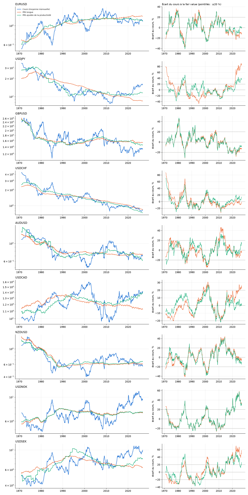
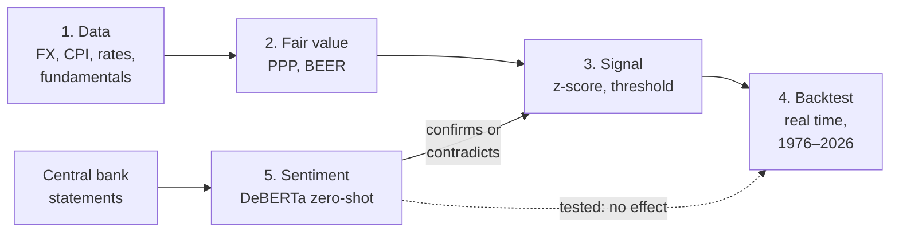
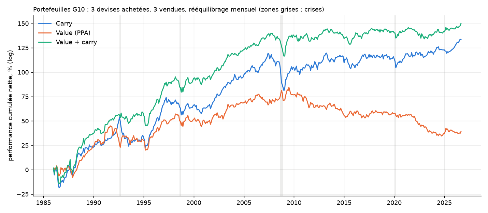

# FX Macro Mispricing Monitor

**Can public macroeconomic information predict exchange rates? A point-in-time test on 50 years of
G10 data: fair values, central bank sentiment and machine learning.**

> **Bottom line.** In a market as liquid as G10 FX, public information is priced almost
> immediately. Fair values, central bank tone read by a transformer, Random Forest and XGBoost all
> fail to beat a coin flip out of sample. Short of knowing something before the market does,
> predicting these exchange rates from public data is, in practice, not possible. What remains is a
> risk premium (carry), and it has largely disappeared since 2008.

### Key results

- **PPP pulls, slowly**: about 20 % of the gap to PPP closes in two years ($t \approx -2.1$, 9 pairs, 1976–2026).
- **But it is not a trading signal**: 53 % hit rate on 144 independent observations ($p = 0.45$).
- **Most of the apparent edge is look-ahead**: 68 % with full-sample calibration, 54 % in real time.
- **Central bank tone is read correctly but already priced**: DeBERTa anticipates ECB and BoE rate moves, yet FX does not react to it.
- **Machine learning overfits**: XGBoost is right 74 % of the time in training, 51 % out of sample.
- **Carry paid, then stopped**: a G10 value + carry portfolio earned 3.7 % a year since 1986, but 0.6 % since 2008.



*Spot (blue) against PPP (orange) and productivity-adjusted PPP (green), 1971–2026. Rates swing
±20–40 % around their fair value and take years to come back.*

---

## Contents

1. [Pipeline](#1-pipeline)
2. [Data](#2-data)
3. [Fair-value models](#3-fair-value-models)
4. [Signal generation](#4-signal-generation)
5. [Backtest and evaluation](#5-backtest-and-evaluation)
6. [Central bank sentiment](#6-central-bank-sentiment)
7. [Limitations and next steps](#7-limitations-and-next-steps)
8. [Running it](#8-running-it)

Technical details (point-in-time rules, BEER estimates, sentiment method, deployment) are in
[docs/details.md](docs/details.md).

---

## 1. Pipeline



---

## 2. Data

| Data | Source | History |
|---|---|---|
| Exchange rates | FRED, BIS, Yahoo Finance | 1971– |
| Consumer prices | FRED, BIS | 1960– |
| Policy rates | BIS | 1960– (most countries) |
| Current account, terms of trade | OECD, ECB | 2000– |
| GDP per capita | World Bank | 1960– |
| Central bank statements | Fed, ECB, BoE (archives), BoJ, SNB, RBA | 2015– |

Every series is used only from its publication date (CPI for month $m$ from $m+1$); quarterly data
are carried forward, never interpolated. EURUSD before 1999 is the standard "synthetic euro".

---

## 3. Fair-value models

A pair `XXXYYY` is quoted as units of `YYY` per unit of `XXX`.

**Purchasing power parity (main model).** The rate follows relative prices, with a constant that
assumes PPP holds on average since 1971:

$$FV^{PPP}_t = k \cdot \frac{P^{YYY}_t}{P^{XXX}_t}, \qquad \ln k = \frac{1}{T}\sum_{t}\left[\ln S_t - \ln\frac{P^{YYY}_t}{P^{XXX}_t}\right]$$

**BEER** (Clark and MacDonald, 1998). The real exchange rate is regressed on the real rate,
terms-of-trade and current-account differentials. No pair is cointegrated at 5 %, so it enters the
signal only when the Engle-Granger p-value is below 0.10.

**Productivity-adjusted PPP** (Balassa-Samuelson). Adds relative GDP per capita to PPP. Its edge did
not survive the robustness checks, so it is displayed only.

---

## 4. Signal generation

The gap to each fair value is $e_t = \ln(S_t / FV_t)$, standardised by its historical volatility:
$z_t = e_t / \sigma$. The signal averages PPP and BEER (BEER only if cointegrated) and acts beyond
one standard deviation: $z \le -1$, the pair should rise; $z \ge +1$, it should fall. Central bank
tone then grades the signal as strong, moderate or weak. Parameters were fixed before the evaluation.

---

## 5. Backtest and evaluation

Every test re-estimates the models at each date on past data only. A fair value "prices" well if
the rate **comes back to it**, not if it tracks the rate closely.

### 5.1 Look-ahead

| 5 pairs, 2009–2026, 12 months | Hit rate | Mean return | Independent obs. |
|---|---|---|---|
| Full-sample calibration (look-ahead) | 68 % | +4.6 % | 22 |
| Real time | 54 % | +0.9 % | 38 |

Knowing the long-run mean in advance creates most of the apparent edge.

### 5.2 Do gaps predict returns? (9 G10 pairs, 1976–2026)

Regression of the future return on today's gap, $r_{t\to t+h} = \alpha + \beta\,e_t$, pooled across
pairs with Driscoll-Kraay errors, against a naive "fair value" (5-year moving average):

| Pooled $t$ of $\beta$ | 12 months | 24 months | Half-life |
|---|---|---|---|
| PPP | −1.76 | **−2.09** | 55 months |
| Productivity-adjusted PPP | −1.80 | −2.11 | 48 months |
| 5-year moving average | −0.51 | −1.11 | 46 months |

PPP has a real but slow pull ($\beta \approx -0.17$ at 24 months). A fixed-effects variant, added
after the first results, gives the same picture.

### 5.3 Does the trading rule work?

| Rule $\lvert z\rvert \ge 1$, 9 pairs | 12 months | 24 months |
|---|---|---|
| PPP | 49 %, p = 0.85 | 53 %, p = 0.45 |
| Productivity-adjusted PPP | 50 %, p = 0.95 | 54 %, p = 0.35 |
| 5-year moving average | 46 %, p = 0.30 | 49 %, p = 0.86 |

No. A 62 % hit rate on the first 5 pairs ($p = 0.07$) vanished once the other G10 pairs were added.
All tests run are reported, so a $p = 0.07$ among many comparisons is weak evidence.

### 5.4 Machine learning (Random Forest, XGBoost)

Six real-time variables (PPP gaps, carry, momentum, volatility), purged walk-forward 1991–2025,
hyperparameters fixed in advance:

| 12 months | In training | Out of sample | p |
|---|---|---|---|
| Logistic regression | 55 % | 51 % | 0.31 |
| Random Forest | 65 % | 51 % | 1.00 |
| XGBoost | 74 % | 51 % | 1.00 |

Nothing beats a coin flip; the more flexible the model, the more it overfits.

### 5.5 Carry: a risk premium, not a forecast

Each month, buy the 3 G10 currencies with the best value + carry score and sell the 3 worst,
earning interest plus FX moves, net of average costs.



| Value + carry, net | Return / year | Sharpe |
|---|---|---|
| 1986–2007 | 6.3 % | 0.74 |
| 2008–2026 | 0.6 % | 0.10 |

The premium paid for crash risk (−15 % in 2008) and faded as rate gaps between countries collapsed.

---

## 6. Central bank sentiment

Each sentence of the statements is classified hawkish / dovish / neutral by a zero-shot NLI model
(`MoritzLaurer/deberta-v3-base-zeroshot-v2.0`). On 45 hand-labelled sentences it scores **82 %**,
against **62 %** for FinBERT, which measures tone rather than policy stance.

Backtest on 282 archived Fed, ECB and BoE statements (2015–2026):

| | DeBERTa | FinBERT |
|---|---|---|
| Tone anticipates the policy rate (6 months) | yes: ECB +0.55, BoE +0.50 | no |
| Currency reacts to the tone, same day | no ($\rho = -0.01$) | no |
| Sentiment predicts EURUSD / GBPUSD | no | no |

DeBERTa understands central banks, but the market already knows: what moves FX is the surprise
relative to expectations, not the wording of a public statement.

---

## 7. Limitations and next steps

| Limitation | Next step |
|---|---|
| Sentiment is measured against the previous statement, not market expectations | Measure the surprise with same-day 2-year yield moves |
| USDJPY value trap: cheap on PPP since 2013, kept falling because of carry | Combine value with carry in the signal |
| Policy rates stand in for 1-month market rates | Forward-implied rates |
| Sentiment accuracy is in-sample (45 sentences) | Larger held-out labelled set |

---

## 8. Running it

```bash
python3 -m venv .venv
.venv/bin/pip install -r requirements-nlp.txt                    # incl. PyTorch; XGBoost needs: brew install libomp
.venv/bin/python scripts/mettre_a_jour.py                         # data, models, sentiment
.venv/bin/python scripts/backtest_temps_reel.py                   # 5.1
.venv/bin/python scripts/banc_essai_fair_value.py --long          # 5.2
.venv/bin/python scripts/backtest_historique_long.py --horizon 24 # 5.3
.venv/bin/python scripts/backtest_ml.py                           # 5.4
.venv/bin/python scripts/backtest_portefeuille.py                 # 5.5
.venv/bin/python scripts/backtest_sentiment.py --collecter        # 6
.venv/bin/python scripts/etude_evenement_sentiment.py             # 6, event study
.venv/bin/python -m pytest -q                                     # 133 tests
```

- **133 pytest tests**, mostly on synthetic data with a known answer, including checks that no
  real-time estimate changes when future data are altered.
- **A transformer on a 1 GB VM**: DeBERTa ran through ONNX Runtime (peak 687 MB); int8 quantisation
  was rejected (accuracy fell from 82 % to 22 %). Details in [docs/details.md](docs/details.md#8-engineering).
- Stack: pandas, statsmodels, scikit-learn, XGBoost, Hugging Face Transformers, ONNX Runtime, Streamlit.
- Identifiers and comments are in French.

---

## References

- Asness, C., Moskowitz, T. and Pedersen, L. (2013). Value and momentum everywhere. *Journal of Finance*, 68(3).
- Clark, P. B. and MacDonald, R. (1998). Exchange rates and economic fundamentals. IMF Working Paper 98/67.
- Driscoll, J. C. and Kraay, A. C. (1998). Consistent covariance matrix estimation with spatially dependent panel data. *Review of Economics and Statistics*, 80(4).
- Engle, R. F. and Granger, C. W. J. (1987). Co-integration and error correction. *Econometrica*, 55(2).
- Laurer, M. et al. (2024). Building efficient universal classifiers with natural language inference. arXiv:2312.17543.
- Lustig, H., Roussanov, N. and Verdelhan, A. (2011). Common risk factors in currency markets. *Review of Financial Studies*, 24(11).
- Rogoff, K. (1996). The purchasing power parity puzzle. *Journal of Economic Literature*, 34(2).
- Araci, D. (2019). FinBERT: Financial sentiment analysis with pre-trained language models. arXiv:1908.10063.
- Project idea: FrenchQuant, https://www.youtube.com/watch?v=fvqKANpRF4E

---

*Analytical and educational tool. It does not execute trades and nothing in it is investment advice.*
