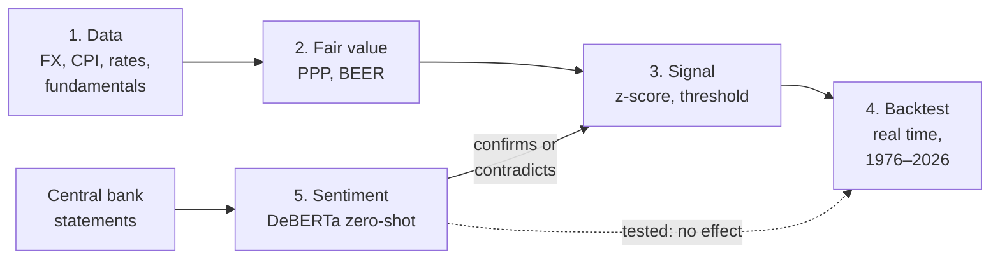

# FX Macro Mispricing Monitor

**Can public macroeconomic information predict exchange rates? A point-in-time test on 50 years of
G10 data: fair values, central bank sentiment and machine learning.**

> **Bottom line.** In a market as liquid as G10 FX, public information is priced almost
> immediately. Every approach tested here (fair values, central bank tone read by a transformer,
> Random Forest, XGBoost) fails to beat a coin flip out of sample. Short of having information
> before the market does, predicting these exchange rates from public data is, in practice, not
> possible. The one durable effect, a slow pull towards purchasing power parity, plays out over
> years and is too weak to trade on.

The project estimates fair values for currency pairs (purchasing power parity and a behavioural
equilibrium exchange rate model), turns the gap between the market rate and the fair value into a
signal, and backtests that signal in real time. A transformer reads central bank statements to
confirm or contradict the signal. Everything runs on free data and is deployed as a dashboard on a
1 GB cloud VM.

### Key results

- **PPP has a slow but measurable pull.** Over 1976–2026 and 9 G10 pairs, the gap to PPP predicts
  the next two years of returns: about **20 % of the gap closes in two years** (pooled $t \approx -2.1$,
  Driscoll-Kraay errors; half-life 4–5 years). A naive moving-average "fair value" has no such pull.
- **It is not a trading signal.** A rule that trades when the gap exceeds one standard deviation is
  right **53 % of the time** on 144 independent observations ($p = 0.45$): indistinguishable from a
  coin flip.
- **Most of the apparent edge is look-ahead.** Calibrated on the full sample, the same rule looks
  right 68 % of the time; re-estimated on past data only, 54 %.
- **Central bank sentiment is read correctly but already priced.** DeBERTa-v3 (zero-shot NLI)
  labels policy stance with 82 % accuracy (FinBERT: 62 %) and its tone anticipates ECB and BoE rate
  moves, yet EURUSD and GBPUSD do not react to it, neither on the day nor in the following months.
- **Machine learning does not help.** In a purged walk-forward test, Random Forest and XGBoost are
  right about 51 % of the time out of sample; XGBoost, right 74 % of the time on its training data,
  simply overfits.


*Spot (blue) against PPP (orange) and productivity-adjusted PPP (green), 1971–2026, with the gap
in % on the right. Rates swing ±20–40 % around their fair value and take years to come back.*

---

## Contents

1. [Pipeline](#1-pipeline)
2. [Data](#2-data)
3. [Fair-value models](#3-fair-value-models)
4. [Signal generation](#4-signal-generation)
5. [Backtest and evaluation](#5-backtest-and-evaluation)
6. [Central bank sentiment overlay](#6-central-bank-sentiment-overlay)
7. [Current snapshot](#7-current-snapshot)
8. [Limitations and next steps](#8-limitations-and-next-steps)
9. [Running it](#9-running-it)

Technical details (point-in-time rules, BEER estimates, sentiment method, deployment) are in
[docs/details.md](docs/details.md).

---

## 1. Pipeline



1. **Data**: free sources, aligned so that each date only uses what was published by then.
2. **Fair value**: PPP (the main model) and BEER.
3. **Signal**: the gap to the fair value, in standard deviations; act beyond ±1.
4. **Backtest**: every model re-estimated at each date on past data only.
5. **Sentiment**: central bank tone grades the strength of the signal.

---

## 2. Data

| Data | Source | History |
|---|---|---|
| Exchange rates | FRED (monthly), Yahoo Finance (daily) | 1971– |
| Consumer prices | FRED, BIS | 1960– |
| Policy rates | BIS | 2000– |
| Current account, terms of trade | OECD, ECB | 2000– |
| GDP per capita (productivity) | World Bank | 1960– |
| Central bank statements | Fed, ECB, BoE, BoJ, SNB, RBA websites | latest |

**Point in time.** Every series is shifted by its publication lag (CPI for month $m$ is used from
$m+1$), and quarterly data are carried forward, never interpolated. EURUSD before 1999 uses the
standard "synthetic euro" (Deutsche mark at the fixed conversion rate). Full rules in
[docs/details.md](docs/details.md#1-point-in-time-data).

---

## 3. Fair-value models

A pair `XXXYYY` is quoted as units of `YYY` per unit of `XXX`; $S_t$ is the spot rate and $P_t$ a
price index.

### 3.1 Purchasing power parity (main model)

If prices rise faster in `YYY`, its currency should depreciate in proportion:

$$FV^{PPP}_t = k \cdot \frac{P^{YYY}_t}{P^{XXX}_t}, \qquad \ln k = \frac{1}{T}\sum_{t=1}^{T}\left[\ln S_t - \ln\frac{P^{YYY}_t}{P^{XXX}_t}\right]$$

The constant assumes PPP holds **on average** over the sample. PPP gaps have a half-life of 3 to 5
years (Rogoff, 1996), so the calibration window must span several cycles: the bot calibrates on
**1971–today**, the whole floating-rate era.

### 3.2 Behavioural equilibrium exchange rate (BEER)

Following Clark and MacDonald (1998), the log real exchange rate is regressed on relative
fundamentals:

$$q_t = \ln S_t + \ln P^{XXX}_t - \ln P^{YYY}_t = \alpha + \beta_1\,\Delta r_t + \beta_2\,\Delta\ln \mathit{ToT}_t + \beta_3\,\Delta \mathit{CA}_t + \varepsilon_t$$

with the real policy-rate differential $\Delta r$, the terms-of-trade differential and the current
account differential. Standard errors are Newey-West. Since $q_t$ and the fundamentals are I(1), the
regression is only meaningful if they are **cointegrated** (Engle-Granger test); otherwise it may be
spurious (Granger and Newbold, 1974). **No pair is cointegrated at 5 %** on 2000–2026, so the BEER
enters the signal only when $p < 0.10$ (today: GBPUSD only). Estimates in
[docs/details.md](docs/details.md#4-beer-estimates).

### 3.3 Productivity-adjusted PPP (displayed only)

The Balassa-Samuelson effect: faster productivity growth raises non-tradable prices, so the real
exchange rate trends upward. Relative real GDP per capita $y$ enters the PPP equation:

$$q_t = a + b\,(y^{XXX}_t - y^{YYY}_t) + \varepsilon_t, \qquad b > 0$$

It fixes the drift of USDJPY, but its advantage over plain PPP did not survive the robustness
checks in section 5, so it is shown on the dashboard and kept out of the signal.

---

## 4. Signal generation

For each model $m$, the gap is $e^m_t = \ln(S_t / FV^m_t)$ (positive: `XXX` overvalued), and its
z-score is $z^m_t = e^m_t / \sigma_m$, with $\sigma_m$ the standard deviation of the gap over the
calibration sample. Valuation combines the models:

$$z^{val}_t = \frac{\sum_m w_m z^m_t}{\sum_m w_m}, \qquad w_{PPP} = w_{BEER} = 0.5 \text{ (BEER only if cointegrated)}$$

| Valuation | Direction |
|---|---|
| $\lvert z^{val}\rvert < 1$ | neutral |
| $z^{val} \le -1$ | `XXXYYY` expected to **rise** |
| $z^{val} \ge +1$ | `XXXYYY` expected to **fall** |

The sentiment overlay (section 6) then grades the strength. All parameters are in `config.yaml`
and were fixed before the evaluation.

---

## 5. Backtest and evaluation

A fair value "prices" well if the rate **comes back to it**, not if it tracks the rate closely.
Three checks, each using only data available at the date: does the look-ahead matter, do gaps
predict returns, and does the trading rule work?

### 5.1 Look-ahead: most of the apparent edge disappears

Calibrating PPP, the BEER and $\sigma_m$ on the full sample tells the model in advance where the
long-run mean lies. Re-estimating at each date on past data only (expanding window), 5 pairs,
2009–2026, 12-month horizon:

| Version | Hit rate | Mean 12-month return | Independent obs. | p (vs 50 %) |
|---|---|---|---|---|
| Full-sample calibration (look-ahead) | 68 % | +4.6 % | 22 | 0.52 |
| Real time, PPP + BEER | 54 % | +0.9 % | 38 | 0.63 |

Monthly 12-month returns overlap, so only non-overlapping observations are counted as independent.
Per-pair results in [docs/details.md](docs/details.md#5-real-time-backtest-20092026).

### 5.2 Do gaps predict returns? (1976–2026)

Seventeen years are too short for gaps with a 4-year half-life, so the test uses monthly data since
1971. For each model, the real-time gap is regressed on the future return:

$$r_{t\to t+h} = \alpha + \beta\,e_t + \varepsilon_t, \qquad r_{t\to t+h} = \ln S_{t+h} - \ln S_t, \quad h \in \{12, 24\} \text{ months}$$

$\beta = -1$ means the gap fully closes within $h$; $\beta = 0$ means no information. Pairs are
pooled with **Driscoll-Kraay** errors, robust to overlapping returns and to shocks common to all
pairs (all are quoted against the dollar). The benchmark is a naive "fair value" equal to the
**5-year moving average** of the rate.

**Pooled $t$ of $\beta$** (more negative = stronger pull towards the fair value):

| Sample | Model | 12 m | 24 m | 24 m, fixed effects | Median half-life |
|---|---|---|---|---|---|
| 5 pairs | PPP | −1.79 | −2.15 | −2.29 | 53 m |
| | Productivity-adjusted PPP | −2.39 | −2.81 | −2.69 | 39 m |
| | 5-year moving average | −0.83 | −1.73 | −1.70 | 38 m |
| **9 pairs (G10)** | PPP | −1.76 | **−2.09** | **−2.26** | 55 m |
| | Productivity-adjusted PPP | −1.80 | −2.11 | −1.91 | 48 m |
| | 5-year moving average | −0.51 | −1.11 | −0.95 | 46 m |

The first specification (plain pooled OLS) was fixed in advance. The fixed-effects version, with
gaps standardised in real time, was **added after seeing the first results**, because USDJPY's large,
persistent gap dominated the pooled slope. Both are reported.

### 5.3 Does the trading rule work?

Rule $\lvert z\rvert \ge 1$, real-time z-scores, hit rate on independent observations, pairs pooled:

| | 5 pairs, 12 m | 5 pairs, 24 m | 9 pairs, 12 m | 9 pairs, 24 m |
|---|---|---|---|---|
| PPP | 50 %, p = 1.00 | 58 %, p = 0.24 | 49 %, p = 0.85 | 53 %, p = 0.45 |
| Productivity-adjusted PPP | 54 %, p = 0.46 | 62 %, p = 0.07 | 50 %, p = 0.95 | 54 %, p = 0.35 |
| 5-year moving average | 47 %, p = 0.63 | 52 %, p = 0.81 | 46 %, p = 0.30 | 49 %, p = 0.86 |

### 5.4 Conclusions

- **Supported: a slow pull towards PPP.** Pooled $\beta \approx -0.17$ at 24 months on 9 pairs:
  about 20 % of the gap closes in two years. This matches the PPP literature, and PPP beats the
  naive anchor.
- **Not supported: a reliable trading signal.** No hit rate is distinguishable from 50 %. The best
  figure (62 %, $p = 0.07$) fell to 54 % once four new G10 pairs were added, where it had no edge.
  More pairs do not add independent time: a dollar move hits every pair at once, so there are only
  about 49 independent two-year periods.
- **Not supported: the productivity adjustment.** Its edge on the first five pairs did not hold
  before 2000, with fixed effects, or on the G10.
- **Disclosure.** Everything tried is reported: five fair values, three horizons (6, 12, 24 months),
  two panel specifications, two sub-periods (1976–2000, 2001–2026) and two sets of pairs. With that
  many comparisons, $p = 0.07$ is weak evidence.

**What the bot does with this.** PPP is used as a **two-year valuation anchor**, not a timing tool.
Returns exclude carry and transaction costs: this is a test of predictive content, not of
profitability.

### 5.5 Does a more flexible model help? (Random Forest, XGBoost)

Same question, with machine learning: predict the sign of the 12-month (and 3-month) return of the
9 G10 pairs from six real-time variables (PPP gap, productivity-adjusted PPP gap, carry, 3- and
12-month momentum, volatility). Walk-forward from 1991 to 2025, re-trained every year on past
data only, with a purge so that no training return overlaps the test year; hyperparameters fixed
in advance (`scripts/backtest_ml.py`).

| Model, 12 months | Hit rate, training | Hit rate, out of sample | p (35 independent obs.) |
|---|---|---|---|
| Logistic regression | 55 % | 51 % | 0.31 |
| Random Forest | 65 % | 51 % | 1.00 |
| XGBoost | 74 % | 51 % | 1.00 |

Nothing changes: no model beats a coin flip, and the more flexible the model, the more it overfits.
XGBoost's probabilities are even significantly worse than the logistic regression's
(Diebold-Mariano $t = -2.7$), and all three do slightly worse than always predicting 50 %. Same
result at 3 months and in both sub-periods.

---

## 6. Central bank sentiment overlay

**Method.** Statements from the Fed, ECB, BoE, BoJ, SNB and RBA are split into sentences, and each
sentence is classified by `MoritzLaurer/deberta-v3-base-zeroshot-v2.0`, a model trained only for
natural language inference. It scores whether the sentence entails "This is hawkish.", "This is
dovish." or "This is neutral." and has never been trained on those words. A statement's score
averages $P(\text{hawkish}) - P(\text{dovish})$ across sentences, weighted by how much policy
signal each carries.

**Accuracy on 45 hand-labelled sentences:**

| Model | Accuracy | F1 hawkish | F1 dovish |
|---|---|---|---|
| **DeBERTa-v3 zero-shot (NLI)** | **0.82** | 0.80 | 0.85 |
| FinBERT | 0.62 | 0.37 | 0.65 |

FinBERT measures **tone**, not **policy stance**: "Inflation remains well above target and further
tightening may be required" sounds negative, so FinBERT calls it dovish. Caveat: the hypothesis
wording was chosen on these same sentences, so 82 % is optimistic.

**Use in the signal.** If the undervalued currency's central bank is more hawkish than the other by
at least 0.15, the signal is **strong**; more dovish by 0.15, **weak**; otherwise **moderate**.

**Backtest on 282 archived statements (Fed, ECB, BoE, 2015–2026; `scripts/backtest_sentiment.py`,
`scripts/etude_evenement_sentiment.py`).**

| Test | DeBERTa | FinBERT |
|---|---|---|
| Tone anticipates the policy rate over 6 months (rank correlation) | ECB +0.55, BoE +0.50 (p ≈ 0.01), Fed +0.30 | ≈ 0 |
| Sentiment alone predicts EURUSD / GBPUSD at 1 or 3 months | no (36–55 % hit rate) | no |
| Currency moves with the change in tone on the statement day | no ($\rho = -0.01$) | no |
| Sentiment improves the valuation signal | no evidence | no evidence |

DeBERTa understands central banks: when it reads a statement as hawkish, rates do rise afterwards.
But the market already knows: the currency does not react to the tone, even on the day. What
moves FX is the surprise relative to market expectations, not the wording of a public statement.

---

## 7. Current snapshot

*23 October 2026. Model output, not investment advice.*

| Pair | Spot | Gap to PPP | $z^{PPP}$ | $z^{BEER}$ (cointegrated?) | Signal |
|---|---|---|---|---|---|
| EURUSD | 1.120 | −13.0 % | −0.90 | +0.94 (no) | neutral |
| USDJPY | 156.81 | +85.8 % | **+2.31** | +1.57 (no) | **USDJPY ↓, weak** |
| GBPUSD | 1.338 | −13.4 % | −1.08 | +1.38 (yes, p = 0.06) | neutral |
| USDCHF | 0.824 | −2.4 % | −0.14 | −0.50 (no) | neutral |
| AUDUSD | 0.704 | −4.2 % | −0.27 | −1.01 (no) | neutral |

The yen is far below PPP, but the signal is weak because the Fed scores more hawkish than the BoJ.
This is also the model's main failure: the yen has looked cheap since 2013 and kept falling, because
the rate differential pays investors to hold dollars (carry).

---

## 8. Limitations and next steps

| Limitation | Next step |
|---|---|
| Sentiment is measured against the previous statement, not against market expectations | Measure the surprise with same-day moves in 2-year yields |
| **USDJPY value trap**: cheap on PPP since 2013, kept depreciating because of carry | Carry filter: downgrade a valuation signal that runs against a large rate differential; test it in the backtest |
| Returns exclude carry and costs | Carry-adjusted returns |
| BEER not cointegrated; current account has the wrong sign for 3 pairs | Net foreign assets instead of current account, dynamic OLS, panel estimation |
| Sentiment accuracy is in-sample | Larger, independently labelled held-out set |

---

## 9. Running it

```bash
python3 -m venv .venv
.venv/bin/pip install -r requirements-nlp.txt                    # incl. PyTorch
.venv/bin/python scripts/exporter_onnx.py                         # one-off: NLI model to ONNX
.venv/bin/python scripts/mettre_a_jour.py                         # data, models, sentiment
.venv/bin/python scripts/banc_essai_fair_value.py --long          # section 5.2
.venv/bin/python scripts/backtest_historique_long.py --horizon 24 # section 5.3
.venv/bin/python scripts/backtest_temps_reel.py                   # section 5.1
.venv/bin/python scripts/backtest_ml.py                           # section 5.5 (needs: brew install libomp)
.venv/bin/python scripts/backtest_sentiment.py --collecter        # section 6 (archives + scoring)
.venv/bin/python scripts/etude_evenement_sentiment.py             # section 6, event study
.venv/bin/streamlit run app/tableau_de_bord.py                    # dashboard, localhost:8501
.venv/bin/python -m pytest -q                                     # 126 tests
```

A FRED API key in `.env` (`FRED_API_KEY=...`) is optional.

**Engineering notes.**

- **126 pytest tests**, mostly on synthetic data with a known answer. For example, the BEER recovers
  simulated coefficients, and no real-time estimate or walk-forward prediction changes when future
  data are altered.
- **A transformer on a 1 GB VM.** DeBERTa runs through ONNX Runtime with memory-mapped float32
  weights (peak 687 MB, same output as PyTorch). Int8 quantisation was rejected because accuracy
  fell from 82 % to 22 %.
- **Deployment**: systemd timer twice a day, Streamlit behind an SSH tunnel, and a cache fallback
  that flags stale sources.
- Stack: pandas, statsmodels, Hugging Face Transformers, ONNX Runtime, Streamlit, AWS EC2.
  Details in [docs/details.md](docs/details.md#8-engineering).

```
fxmacro/
├── donnees/      # data sources, cache, point-in-time alignment, 1971+ history
├── fair_value/   # PPP, BEER, productivity PPP, z-scores, test bench
├── signaux/      # signal rule, real-time backtest
├── sentiment/    # scraping, zero-shot NLI (PyTorch & ONNX), FinBERT, evaluation
├── regime/       # macro regimes (descriptive, dashboard only: see docs/details.md)
└── pipeline.py
app/  scripts/  tests/  deploiement/  config.yaml
```

*Identifiers and comments are in French.*

---

## References

- Clark, P. B. and MacDonald, R. (1998). *Exchange Rates and Economic Fundamentals: A
  Methodological Comparison of BEERs and FEERs.* IMF Working Paper 98/67.
- Driscoll, J. C. and Kraay, A. C. (1998). Consistent covariance matrix estimation with spatially
  dependent panel data. *Review of Economics and Statistics*, 80(4).
- Engle, R. F. and Granger, C. W. J. (1987). Co-integration and error correction: representation,
  estimation, and testing. *Econometrica*, 55(2).
- Granger, C. W. J. and Newbold, P. (1974). Spurious regressions in econometrics. *Journal of
  Econometrics*, 2(2).
- Newey, W. K. and West, K. D. (1987). A simple, positive semi-definite, heteroskedasticity and
  autocorrelation consistent covariance matrix. *Econometrica*, 55(3).
- Rogoff, K. (1996). The purchasing power parity puzzle. *Journal of Economic Literature*, 34(2).
- Laurer, M., van Atteveldt, W., Casas, A. and Welbers, K. (2024). Building efficient universal
  classifiers with natural language inference. arXiv:2312.17543.
- Araci, D. (2019). FinBERT: Financial sentiment analysis with pre-trained language models.
  arXiv:1908.10063.
- Project idea: FrenchQuant, https://www.youtube.com/watch?v=fvqKANpRF4E

---

*This project is an analytical and educational tool. It does not execute trades and nothing in it
constitutes investment advice.*
